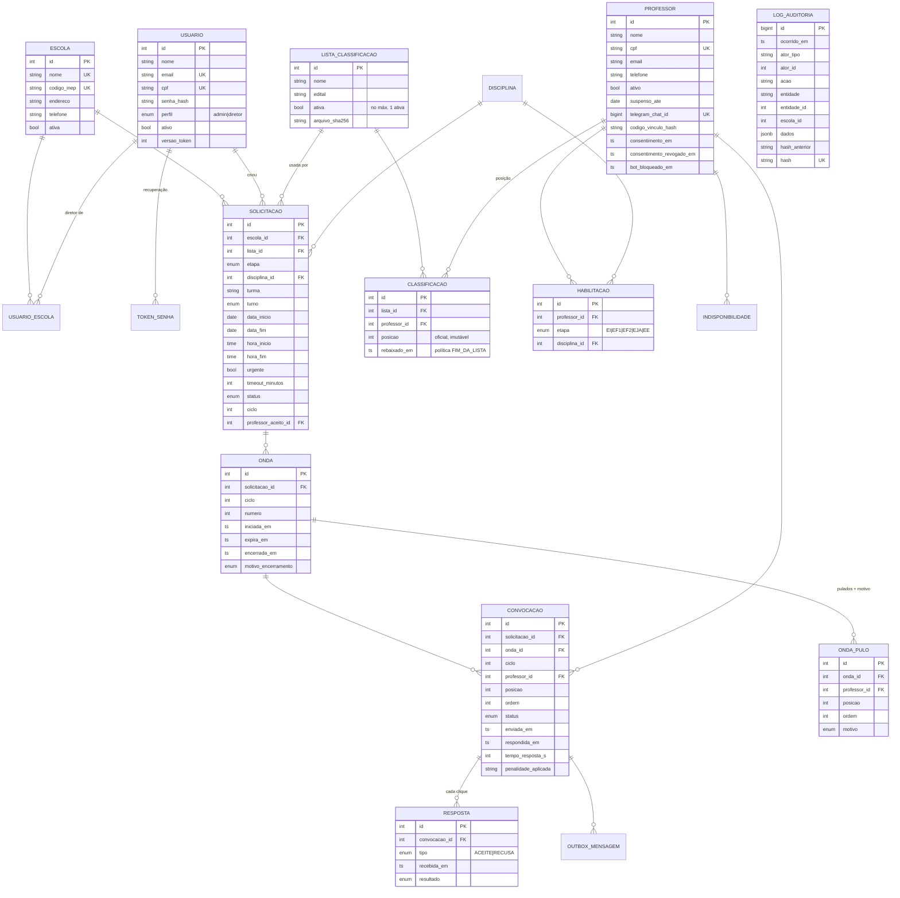
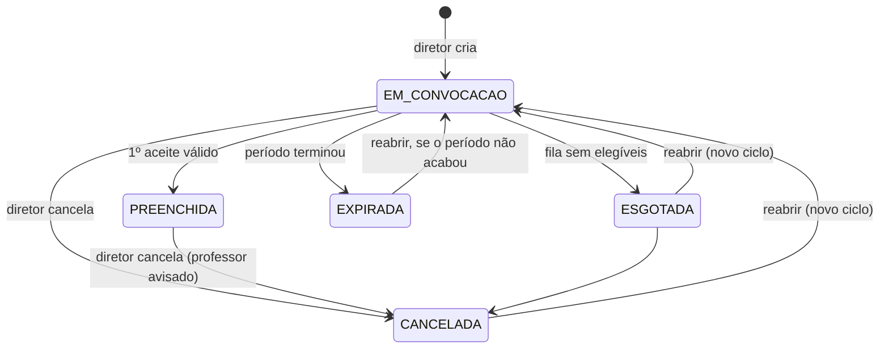

# 1. Modelo de dados

PostgreSQL 14+. Instantes em `timestamptz` (UTC). Datas e horários de aula em `date`/`time`,
interpretados em America/Sao_Paulo. Código: [`backend/app/models.py`](../backend/app/models.py).

Tabelas de apoio: `disciplina`, `indisponibilidade`, `configuracao` (linha única com as regras),
`outbox_mensagem` (fila de envio), `bot_sessao` (estado da conversa de vínculo), `token_senha`
e `log_acesso` (LGPD).

## Decisões importantes

| Ponto | Decisão |
|---|---|
| Posição oficial | `classificacao.posicao` nunca muda. "Fim da lista" grava `rebaixado_em`, e a fila é ordenada por `(rebaixado_em NULLS FIRST, rebaixado_em, posicao)`. |
| Ordem efetiva | `convocacao.ordem` e `onda_pulo.ordem` guardam a posição na fila **no momento da onda**. Com isso dá para reconstruir a decisão depois. |
| Um aceite por vaga | Índice único parcial `uq_convocacao_um_aceite (solicitacao_id, ciclo) WHERE status='ACEITA'`, além do lock de linha. |
| Ciclos | Reabrir incrementa `solicitacao.ciclo`. Convocações são únicas por `(solicitacao, ciclo, professor)`. |
| Uma lista ativa | Índice único parcial `uq_lista_ativa WHERE ativa`. |
| Exclusão | Escolas e usuários usam exclusão lógica (`ativa`/`ativo`), porque o histórico precisa continuar consultável. |
| Auditoria | Trigger `BEFORE UPDATE OR DELETE` e `BEFORE TRUNCATE` levanta exceção. `hash = sha256(hash_anterior + registro canônico)`. |
| LGPD | `codigo_vinculo_hash` (nunca o código em claro); CPF mascarado nas respostas da API (`***.456.789-**`); diretor só vê o contato de quem aceitou. |

## Estados

Convocação: `ENVIADA → ACEITA | RECUSADA | SEM_RESPOSTA (timeout) | VAGA_PREENCHIDA | CANCELADA | FALHA_ENVIO | INELEGIVEL`.
De `SEM_RESPOSTA` ainda é possível ir para `ACEITA` ou `RECUSADA` (resposta tardia), enquanto a vaga estiver aberta.
