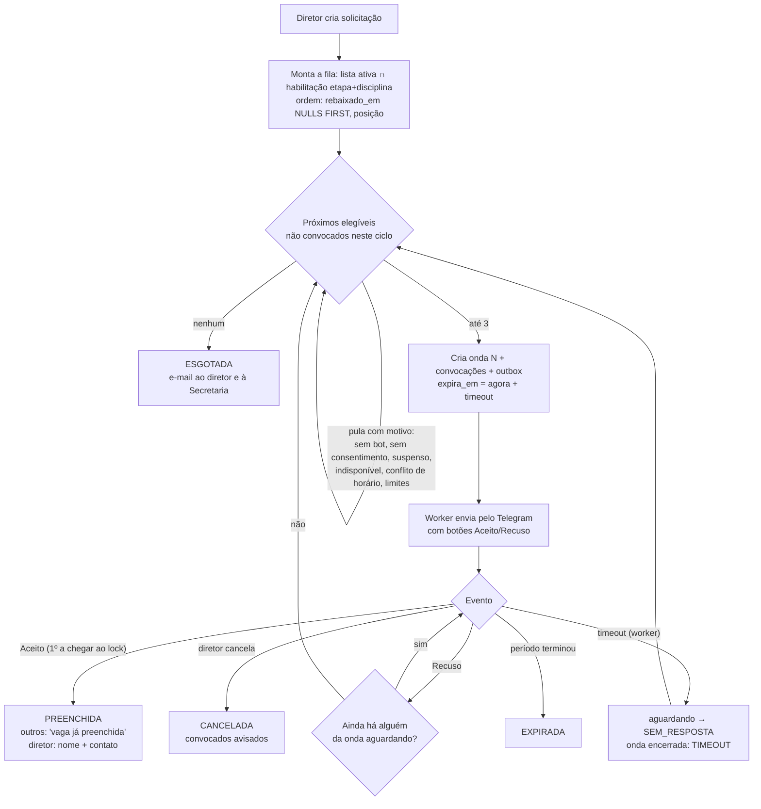
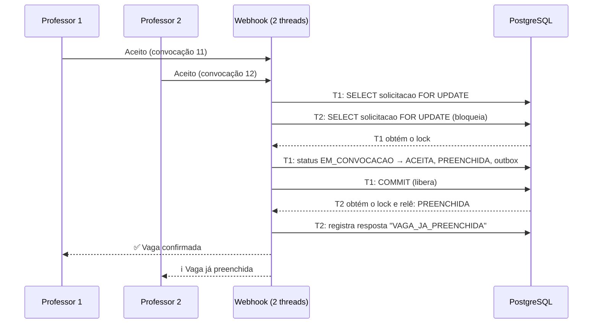

# 2. Fluxo de convocação por ondas

Código: [`backend/app/services/motor.py`](../backend/app/services/motor.py) e
[`elegibilidade.py`](../backend/app/services/elegibilidade.py).

## 2.1 Fluxo principal



## 2.2 Concorrência: por que dois professores nunca ficam com a mesma vaga

Toda transição de estado de uma vaga começa com `SELECT … FROM solicitacao WHERE id=? FOR UPDATE`.
Isso vale para aceite, recusa, timeout, cancelamento, reabertura e falha de envio. A linha da
solicitação funciona como um mutex por vaga.



Ordem fixa de locks, para evitar deadlock:

1. linha da **solicitação**;
2. linhas de **professor** envolvidas (quem responde e quem pode ser penalizado), todas de uma vez, em ordem crescente de `id`;
3. **advisory lock da auditoria**, sempre no `before_commit`.

Defesa em profundidade: o índice único parcial `uq_convocacao_um_aceite` faz o banco recusar
um segundo `ACEITA` mesmo se algum caminho de código esquecer o lock. Isso é testado.

## 2.3 Casos de borda

| Caso | Comportamento | Teste |
|---|---|---|
| Aceites simultâneos (3 ou 10 threads) | Exatamente 1 `VAGA_CONCEDIDA`; os demais recebem `VAGA_JA_PREENCHIDA` | `test_tres_aceites_simultaneos…`, `test_dez_aceites…` |
| Mesmo professor aceita duas vagas com conflito de horário ao mesmo tempo | O professor é travado no aceite: uma vaga é concedida e a outra vira `CONFLITO` (`INELEGIVEL`) | `test_mesmo_professor_aceita_duas_vagas…` |
| Aceite chega junto com o timeout | Serializados pelo lock. Como o aceite tardio é permitido, a vaga fica com quem aceitou em qualquer ordem | `test_aceite_versus_timeout` |
| Aceite chega junto com o cancelamento | Se o aceite vem primeiro, o professor fica `ACEITA` e recebe o aviso de cancelamento. Se o cancelamento vem primeiro, o aceite recebe "encerrada" | `test_aceite_versus_cancelamento` |
| Todos da onda recusam | Próxima onda imediata, sem esperar o timeout | `test_todos_recusam…`, `test_recusas_simultaneas…` |
| Ninguém responde | O worker fecha a onda (`TIMEOUT`) e dispara a próxima | `test_timeout_dispara_proxima_onda` |
| Aceite tardio (onda já expirada, vaga aberta) | Vale por padrão; é configurável (`PRAZO_ENCERRADO`) | `test_aceite_tardio_*` |
| Fila esgotada | `ESGOTADA`, alerta por e-mail ao diretor e aos admins | `test_fila_esgotada…` |
| Cancelamento no meio do processo | Convocações em aberto viram `CANCELADA` e os professores são avisados; cliques posteriores recebem "encerrada" | `test_cancelamento_no_meio…` |
| Vaga preenchida antes de a mensagem sair | O worker descarta a convocação obsoleta e o aviso de encerramento | `test_mensagem_de_convocacao_obsoleta…` |
| Professor bloqueou o bot (HTTP 403) | `FALHA_ENVIO` + `bot_bloqueado_em`. Se a onda inteira falhar, avança na hora | `test_falha_de_envio_permanente…` |
| Falha temporária (5xx, 429, rede) | Retry com backoff exponencial (5 s, 10 s, 20 s… até 15 min), máximo de 6 tentativas | `test_falha_temporaria…` |
| Período da aula terminou sem aceite | `EXPIRADA` + e-mail ao diretor | `test_expira_quando…` |
| Reabrir | Novo ciclo do topo; botões do ciclo anterior deixam de valer | `test_reabrir…` |
| Clique repetido ou update reenviado pelo Telegram | Idempotente (`JA_RESPONDIDA`), e todo clique fica em `resposta` | `test_resposta_repetida…` |
| Vários workers | Outbox com `FOR UPDATE SKIP LOCKED`; timers com `SKIP LOCKED` na solicitação | `test_workers_concorrentes…` |
| Deadlock detectado pelo Postgres (raro) | O webhook devolve 500 e o Telegram reenvia; o worker repete no ciclo seguinte | — |

## 2.4 Penalidades (configuráveis)

| Evento | Quando aplica | Opções |
|---|---|---|
| Recusa | Na hora | `MANTER` (padrão), `FIM_DA_LISTA`, `SUSPENDER n dias` |
| Sem resposta | No **encerramento** da vaga (preenchida, esgotada ou expirada), **nunca** no cancelamento. Quem recebeu "vaga preenchida" antes do prazo não é penalizado | idem |

## 2.5 Garantia de entrega

```
transação do motor ──► grava estado + linha no outbox (mesmo COMMIT)
worker ──► SELECT outbox PENDENTE FOR UPDATE SKIP LOCKED ──► Telegram/SMTP
         ├─ ok          → ENVIADA (+ message_id na convocação)
         ├─ temporária  → PENDENTE, proxima_tentativa_em = agora + backoff
         └─ permanente  → FALHA → motor.falha_envio() (pode avançar a onda)
```

A entrega é *at-least-once*: se o worker cair depois de enviar e antes do commit, a mensagem
pode sair duas vezes. Isso é inofensivo porque os botões são idempotentes.
