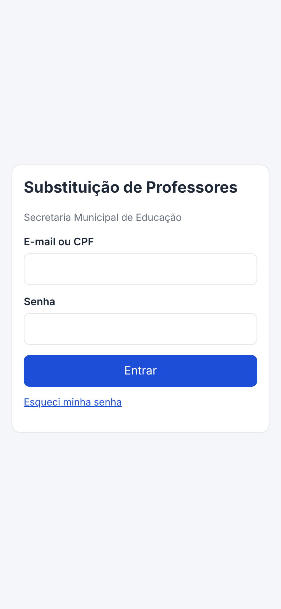
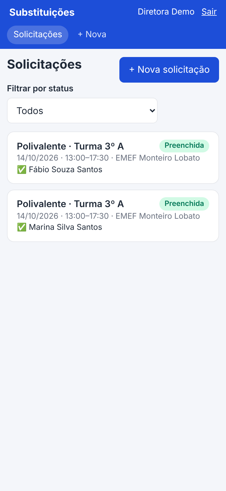
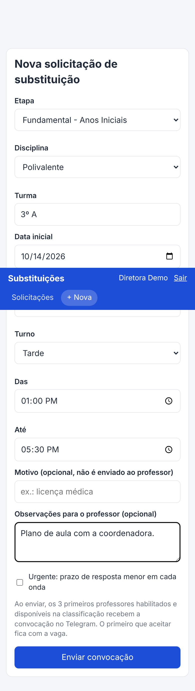
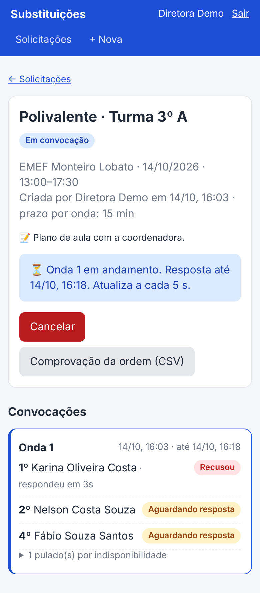
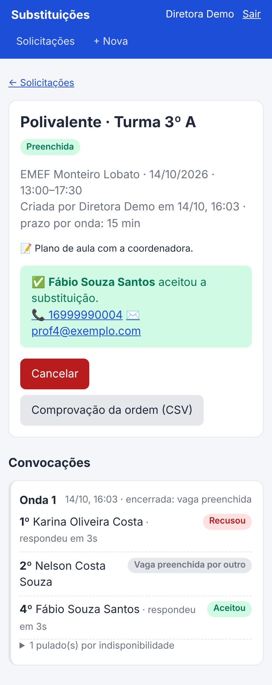
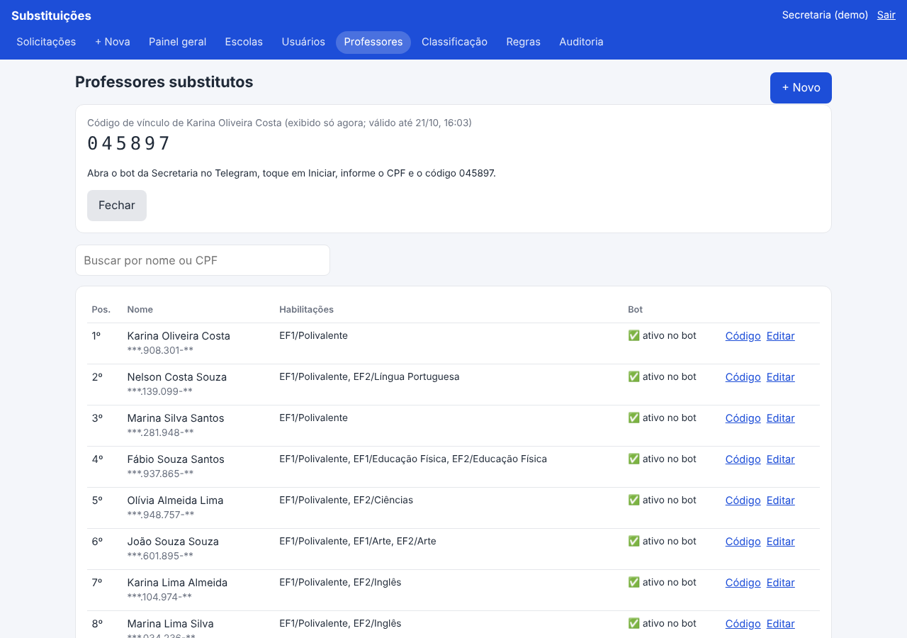
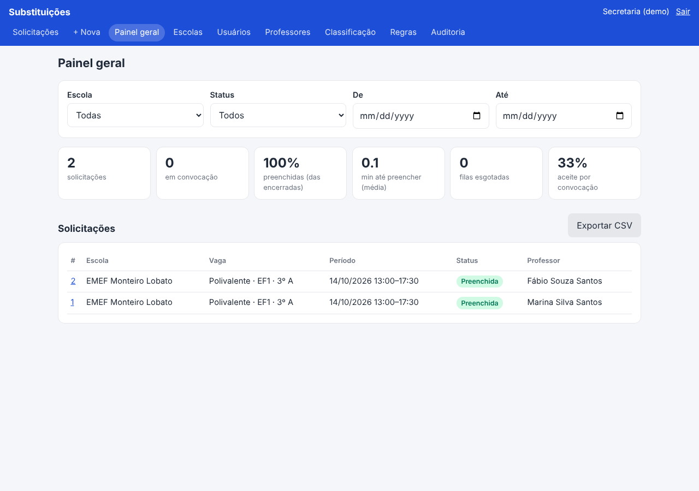
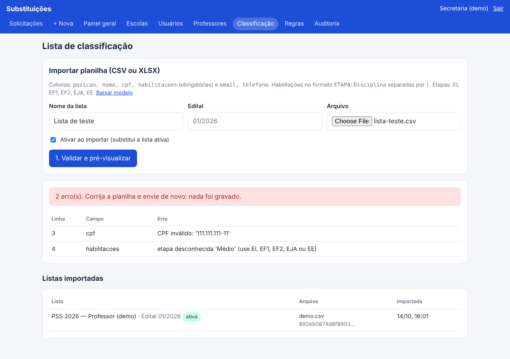
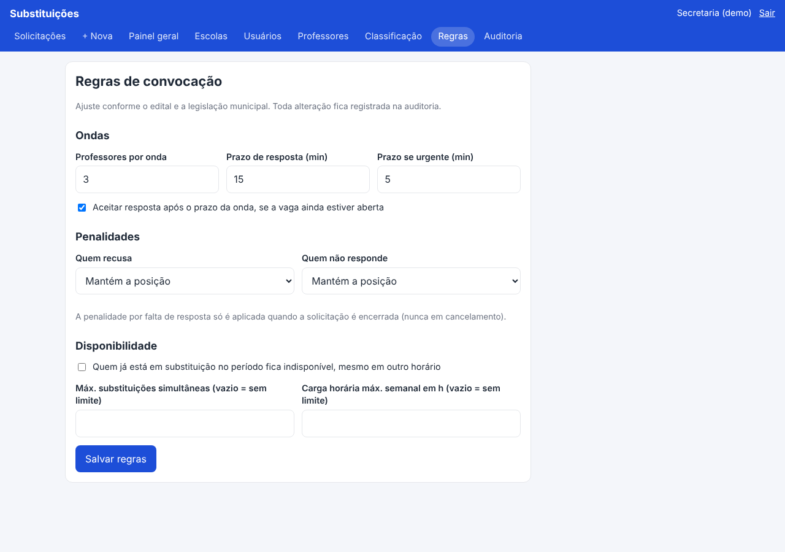
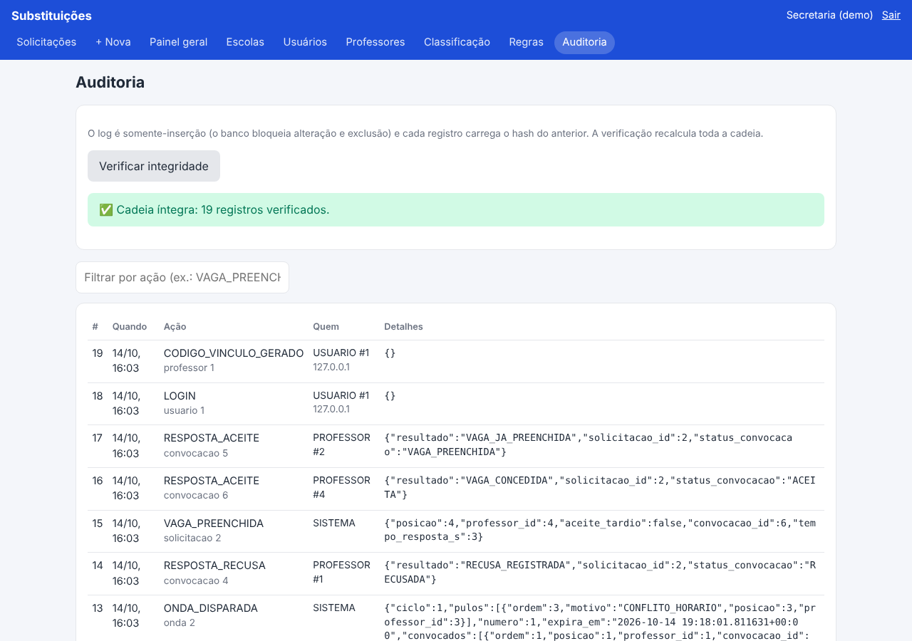

# 3. Wireframes

O layout prioriza o celular: o diretor abre a vaga no corredor da escola. Abaixo estão os
wireframes de baixa fidelidade e, em seguida, capturas do MVP rodando (geradas com Playwright
em 390×844 e 1280×900).

## 3.1 Login
```
┌──────────────────────────────┐
│  Substituição de Professores │
│  Secretaria de Educação      │
│                              │
│  E-mail ou CPF               │
│  [__________________________]│
│  Senha                       │
│  [__________________________]│
│  [          Entrar          ]│
│  Esqueci minha senha         │
└──────────────────────────────┘
```

## 3.2 Painel do diretor
```
┌──────────────────────────────┐
│ Substituições   Diretora Sair│
│ (Solicitações) (+ Nova)      │
├──────────────────────────────┤
│ Solicitações  [+ Nova solic.]│
│ ⓘ 1 em convocação agora      │
│ Status: [Todos ▾]            │
│ ┌──────────────────────────┐ │
│ │Polivalente·3ºA [Em conv.]│ │
│ │20/10 · 07:00–11:30       │ │
│ │Onda 2 · até 10:32        │ │
│ └──────────────────────────┘ │
│ ┌──────────────────────────┐ │
│ │Matemática·7ºB [Preench.] │ │
│ │✅ Ana Souza              │ │
│ └──────────────────────────┘ │
└──────────────────────────────┘
```

## 3.3 Nova solicitação
```
┌──────────────────────────────┐
│ Nova solicitação             │
│ Escola   [EMEF A ▾] (se >1)  │
│ Etapa    [Anos iniciais ▾]   │
│ Disciplina [Polivalente ▾]   │
│ Turma    [3º A]              │
│ Data ini [20/10] Data fim[..]│
│ Turno [Manhã ▾] Das[07:00]   │
│                 Até[11:30]   │
│ Motivo (interno)  [.......]  │
│ Observações p/ professor [..]│
│ ☐ Urgente (prazo menor)      │
│ [     Enviar convocação     ]│
└──────────────────────────────┘
```

## 3.4 Acompanhamento (atualiza a cada 5 s)
```
┌──────────────────────────────┐
│ ← Solicitações               │
│ Polivalente · 3º A [Em conv.]│
│ EMEF A · 20/10 · 07:00–11:30 │
│ ⏳ Onda 2 · resposta até 10:32│
│ [Cancelar] [Comprovação CSV] │
│                              │
│ ▌Onda 2   10:17 · até 10:32  │
│ ▌4º Fábio ....... Aguardando │
│ ▌5º Carla ....... Recusou    │
│ ▌6º Hugo ........ Aguardando │
│ ▌▸ 1 pulado (indisponível)   │
│                              │
│ │Onda 1 · encerrada: prazo   │
│ │1º Karina ...... Não resp.  │
│ │2º Nelson ...... Recusou    │
│ │3º Marina ...... Não resp.  │
└──────────────────────────────┘
 Ao preencher: caixa verde com nome, 📞 telefone (link tel:) e e-mail.
```

## 3.5 Painel admin (desktop)
```
┌─────────────────────────────────────────────────────────────────────┐
│ Substituições  Solicitações | Painel geral | Escolas | Usuários |   │
│                Professores | Classificação | Regras | Auditoria    │
├─────────────────────────────────────────────────────────────────────┤
│ Escola [Todas ▾] Status [Todos ▾] De [__] Até [__]                  │
│ ┌──────┐┌──────┐┌──────┐┌──────┐┌──────┐┌──────┐                    │
│ │ 42   ││  3   ││ 91%  ││ 6,5  ││  1   ││ 38%  │                    │
│ │total ││em conv││preench││min mé││esgot.││aceite│                    │
│ └──────┘└──────┘└──────┘└──────┘└──────┘└──────┘                    │
│ Solicitações                                    [Exportar CSV]      │
│ # │ Escola │ Vaga │ Período │ Status │ Professor                    │
└─────────────────────────────────────────────────────────────────────┘
Classificação: upload → [1. Validar] → erros por linha / prévia → [2. Confirmar]
Professores: lista por posição, situação no bot, [Código] gera vínculo de 6 dígitos
Regras: tamanho da onda, prazos, penalidades, limites
Auditoria: [Verificar integridade] + log filtrável
```

## 3.6 Bot (Telegram)
```
┌ Convocação para substituição ───────┐
│ 🏫 EMEF Monteiro Lobato              │
│ 📅 20/10/2026                        │
│ 🕒 07:00–11:30 (Manhã)               │
│ 📚 Polivalente · Anos Iniciais       │
│ 👥 Turma 3º A                        │
│ 📝 Plano de aula na coordenação      │
│ Responda até 20/10/2026 06:45.       │
│ A vaga fica com quem aceitar primeiro│
│   [ ✅ Aceito ]   [ ❌ Recuso ]       │
└──────────────────────────────────────┘
Comandos: /status  /minhas  /indisponivel 20/10 25/10 [motivo]  /privacidade  /sair
```

## 3.7 MVP rodando

| | |
|---|---|
|  |  |
|  |  |
|  |  |





